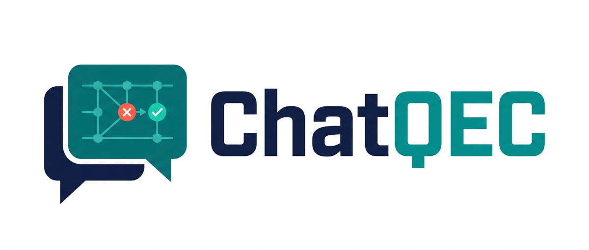
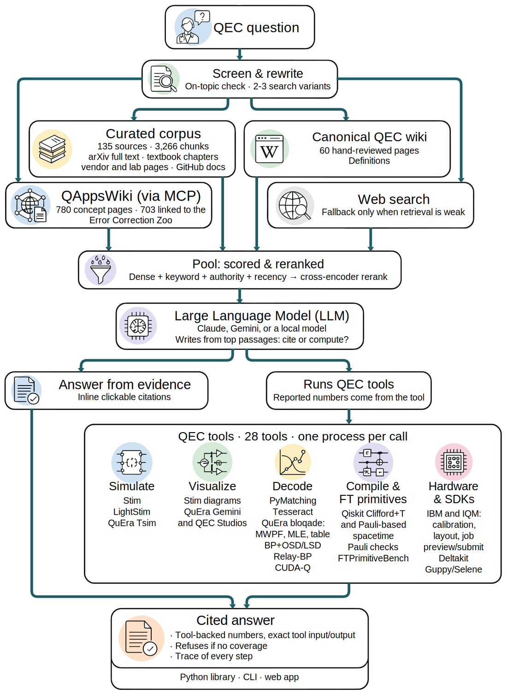

<p align="center">
  
</p>

An open-source research assistant for **Quantum Error Correction**.

Ask QEC questions and get answers that are either cited from a curated corpus
(papers, textbook chapters, vendor and lab pages, and a hand-reviewed canonical
wiki), computed by a real tool, or an honest refusal. The model can run 28 QEC
tools: [Stim](https://github.com/quantumlib/Stim) simulation, a dozen decoders,
fault-tolerant compilation, FTPrimitiveBench and decoder-bench circuits, QuEra's
Tsim, Gemini Studio, and QEC Studio, and IBM Quantum and IQM hardware tools
(calibration, mapping, preview, submit). Use it as a Python library, a CLI, or a
Streamlit web app.

> **Status: research prototype (v0.1.0), Apache-2.0.** Installs with one script
> or opens in GitHub Codespaces (see [Install](#install)). The public release
> indexes the 60-page canonical wiki; the full corpus is loaded from a snapshot.

<p align="center">
  
</p>

---

## Why

General chat assistants are unreliable on QEC: they confuse code distances,
misquote thresholds, invent paper titles, and cannot run the circuit they
describe. ChatQEC is built for QEC, with:

- **A canonical wiki** of hand-reviewed pages (surface code, stabilizer
  formalism, CSS codes, threshold theorem, magic state distillation, and more)
  injected into retrieval for definitional questions, so "what is the surface
  code?" always gets the canonical page.
- **Hybrid retrieval** (dense vectors, BM25, authority tier, recency, then a
  cross-encoder reranker) over a typed source registry.
- **Inline citations** the reader can click and verify.
- **28 QEC tools**, so circuit-level questions get a computed answer, not a guess.
- **Honest refusals** when the evidence is not there.

---

## Install

### In the browser: GitHub Codespaces

[](https://codespaces.new/QSCSoftwareEcosystem/ChatQEC?quickstart=1)

Add a `GEMINI_API_KEY` [Codespaces secret](https://github.com/settings/codespaces)
first (an `ANTHROPIC_API_KEY` is optional). The Codespace installs everything,
indexes the canonical wiki, and opens the app on port 8501. Setup takes a few
minutes the first time. Without a key it still installs; add the key and run
`uv run chatqec bootstrap`, then `bash .devcontainer/start.sh`.

### On your machine (Linux x86_64)

```bash
git clone https://github.com/QSCSoftwareEcosystem/ChatQEC && cd ChatQEC
export GEMINI_API_KEY=...          # or put it in .env; ANTHROPIC_API_KEY is optional
bash .devcontainer/setup.sh        # uv, Qdrant, the app, the CPU QEC tools, the index
bash .devcontainer/start.sh        # web app on http://localhost:8501
uv run chatqec ask --mcp-server chatqec-tools "What is the surface code?"
```

The same steps by hand:

```bash
uv sync                                   # the app (add --extra dev for tests)
uv tool install ./packages/chatqec-tools  # the QEC tools (add extras, see below)
uv run chatqec bootstrap                  # starts Qdrant if needed, indexes the canonical wiki
```

**Keys.** A Gemini key is the one requirement: retrieval embeds every question
with `gemini-embedding-001`, and Gemini also answers when no Anthropic key is set.
With `ANTHROPIC_API_KEY`, Claude answers instead. To run on your own models, set
`models.provider: local` in `conf/config.yaml` (any OpenAI-compatible server).

**Qdrant.** `bootstrap` and the web app start a local `qdrant` binary if one is
on `PATH` (`setup.sh` downloads it), or run `docker compose up -d`. Set
`CHATQEC_AUTOSTART_QDRANT=0` to switch autostart off on a hosted deploy.

**Corpus.** `chatqec bootstrap` indexes the 60 canonical pages shipped in this
repository, so definitional questions get cited answers and every tool works.
The full corpus (135 sources: arXiv papers, vendor pages, and textbook
chapters) is not redistributed here; if you have a Qdrant snapshot of it, load
it with `uv run chatqec bootstrap --force --snapshot <file-or-url>` (or set
`CHATQEC_INDEX_SNAPSHOT` before the Codespace is created). To add sources
yourself, see [`docs/INGESTION.md`](docs/INGESTION.md).

---

## Example usage

```bash
# Definitional: answered from the canonical wiki
uv run chatqec ask "What is the surface code and how does it detect errors?"

# Needs a simulator, not a guess
uv run chatqec ask --mcp-server chatqec-tools \
  "Simulate a distance-3 surface code under depolarizing noise at p=0.001 for 5000 shots and report the logical error rate."

# Interactive REPL
uv run chatqec chat
```

The web app (`bash .devcontainer/start.sh`, or
`CHATQEC_MCP_SERVER=chatqec-tools uv run streamlit run chatqec_app/streamlit_app.py`)
has four pages: **Chat** (streamed answers with citation cards, tool inputs and
results), **Sources** (the registry), **Watchlist**, and **About**. Set
`CHATQEC_MCP_SERVER` *before* launching: the app builds the assistant once, and
without it the Chat page has no tools.

For a guided tour with real outputs, open
[`notebooks/getting_started.ipynb`](notebooks/getting_started.ipynb) (every tool
called directly, then a few questions); more example queries are in
[`docs/EXAMPLES.md`](docs/EXAMPLES.md).

### CLI commands at a glance

```bash
chatqec ask "..."                    # one-shot question with citations (--image fig.png to attach one)
chatqec chat                         # interactive REPL (/quit, /clear)
chatqec bootstrap [--snapshot PATH]  # start Qdrant and fill the index on a fresh install
chatqec retrieve --query "..."       # retrieval only, no LLM call
chatqec ingest --arxiv <id> --full-text   # add a source (see docs/INGESTION.md)
chatqec embed --all-pending          # embed new sources and mark them active
chatqec sources list                 # registry view
chatqec canonical validate           # check the canonical wiki
chatqec watch refresh --apply        # pull new arXiv/GitHub candidates
chatqec eval run --output eval/results.json   # retrieval eval (62 questions)
```

---

## QEC tools

The tools live in [`packages/chatqec-tools`](packages/chatqec-tools), a separate
uv project, so their heavy extras (CUDA-Q, the Qiskit pins) never enter the
app's environment. The install gives two commands: `chatqec-tools`, which
ChatQEC uses and which runs every call in a fresh process (a timeout kills only
that call, and a crash in a vendor decoder cannot break the session), and
`chatqec-mcp-tools`, the same tools as a stdio MCP server for Claude Desktop,
Claude Code, or any other MCP client.

The model decides on its own when a question needs a computation, and reported
numbers come from the tool's output. The circuit tools also run in a sandbox
with memory and wall-clock limits.

| Group | Tools |
|---|---|
| Circuits and decoding (11) | `stim_simulate`, `stim_diagram`, `glcb_visualize_url`, `pymatching_decode`, `threshold_sweep`, `code_params`, `qec_circuit_build`, `tsim_simulate`, `qec_studio_examples`, `qec_studio_compile`, `qec_studio_link` |
| IBM Quantum (7) | `ibm_list_backends`, `ibm_backend_calibration`, `ibm_map_circuit`, `ibm_preview_execution`, `ibm_submit_execution`, `ibm_add_pauli_checks`, `ibm_ft_compile` |
| IQM (6) | `iqm_list_backends`, `iqm_backend_calibration`, `iqm_map_circuit`, `iqm_preview_execution`, `iqm_submit_execution`, `iqm_job_result` |
| External QEC packages (4) | `decoder_compare`, `ft_primitive_simulate`, `deltakit_memory`, `guppy_run` |

Every tool is always registered; one whose extra is missing returns `ok=False`
with an install hint. `setup.sh` installs the CPU extras; to choose your own:

```bash
uv tool install --force "./packages/chatqec-tools[lightstim,tsim,ibm,decoders,mle,cudaq,paulice,ft,deltakit,guppy,decoderbench,ftprimitive]"
```

| Extra | Enables | Notes |
|---|---|---|
| `lightstim` | `qec_circuit_build`: toric, BB, PQRM, and 6.6.6 color-code circuits Stim does not ship | |
| `tsim` | `tsim_simulate`: Stim circuits with non-Clifford gates (`T`, `R_X`, ...) | |
| `decoders`, `mle`, `cudaq` | `decoder_compare`: PyMatching, Tesseract, BP+OSD/LSD, BP+union-find, MWPF, MLE, lookup table, CUDA-Q Relay-BP, BP+OSD, and sliding window | `mle` uses Gurobi (the pip licence is size-limited, non-production); `cudaq` needs a GPU |
| `decoderbench`, `ftprimitive` | decoder-bench and FTPrimitiveBench circuits | |
| `paulice` | `ibm_add_pauli_checks`: spacetime Pauli checks with their overhead | |
| `ft` | `ibm_ft_compile`: Clifford+T or Pauli-based compilation | Qiskit 2.5 or newer |
| `ibm` | the other `ibm_*` tools | |
| `deltakit` | `deltakit_memory`: Riverlane Deltakit memory experiments | local PyMatching only; the cloud decoders need an account and are refused |
| `guppy` | `guppy_run`: Guppy programs on the Selene emulator | off by default, see below |

> **`guppy_run` executes a program supplied through chat, and there is no OS
> sandbox.** It is disabled unless ChatQEC (or the MCP server) is started with
> `CHATQEC_ALLOW_GUPPY_EXEC=1`; a source gate accepts only `guppylang` imports
> and `@guppy` functions; and the program runs in a separate process with a
> scrubbed environment, a private temporary directory, and CPU, file, memory,
> and time limits. It does not block network access. Enable it only for
> programs you would be willing to run.

### Quantum hardware (IBM Quantum, IQM)

The `ibm_*` tools need the `ibm` extra and `QISKIT_IBM_TOKEN` (optionally
`QISKIT_IBM_INSTANCE`). The `iqm_*` tools run IQM calls in a separate Python
environment, because `iqm-client` pins versions that conflict with the other
extras; create it once, then set `IQM_TOKEN` and `IQM_SERVER_URL`:

```bash
bash packages/chatqec-tools/scripts/setup_iqm_env.sh   # or set CHATQEC_IQM_PYTHON
```

Listing, calibration, mapping, and preview are free. Submission is a separate
tool that the model may call only after the user has seen the preview and asked
to run, and it uses the configured account's allocation (IQM jobs are capped at
10 qubits and 4,000 shots). [`notebooks/hardware_getting_started.ipynb`](notebooks/hardware_getting_started.ipynb)
walks through both.

### QAppsWiki search

ChatQEC can also retrieve prose sections from
[QAppsWiki](https://github.com/QSCSoftwareEcosystem/QAppsWiki) (780 concept
pages, about 700 of them linked to the Error Correction Zoo). Its search runs as
an MCP server over a local clone; name it next to the tools:

```bash
git clone https://github.com/QSCSoftwareEcosystem/QAppsWiki ~/QAppsWiki
CHATQEC_MCP_SERVER="chatqec-tools,sh -c 'PYTHONPATH=$HOME/QAppsWiki/tools python -m qappswiki serve --root $HOME/QAppsWiki'" \
  uv run streamlit run chatqec_app/streamlit_app.py
```

Wiki sections join the corpus candidates in the same rerank pool; `wiki.enabled`
and `wiki.k` in `conf/config.yaml` control it. Details are in
[`docs/DEVELOPER_NOTES.md`](docs/DEVELOPER_NOTES.md#qappswiki-internals).

---

## How it works

```
                       ┌──────────────┐
question  ──▶ Haiku ──▶│  off-topic?  │── no ──▶ refuse politely
                       └──────┬───────┘
                              │ yes
                       ┌──────▼───────┐
                       │   Haiku      │  resolves pronouns,
                       │   rewriter   │  emits 2–3 search variants
                       └──────┬───────┘
                              │
        ┌─────────────────────▼──────────────────────┐
        │      Hybrid retriever (Qdrant + BM25)      │
        │ → weighted scoring → reranker → top-K      │
        │     ▲                                       │
        │     │  canonical wiki force-inject          │
        └─────┼───────────────────────────────────────┘
              │
       ┌──────▼─────────┐         ┌──────────────────────────┐
       │ Sonnet         │  tools  │  chatqec-tools (28)      │
       │ synthesizer    │ ◀────▶ │  one process per call:   │
       │ (cited answer) │         │  Stim, decoders, FT      │
       └────────────────┘         │  compile, QEC Studio,    │
                                   │  IBM Quantum, IQM        │
                                   └──────────────────────────┘
```

Each chunk is scored as `0.5·dense + 0.3·BM25 + 0.15·tier + 0.05·recency`, and
`mxbai-rerank-base-v1` reranks the top candidates. When the best rerank score is
below 0.4 and the web fallback is on (`TAVILY_API_KEY` plus
`CHATQEC_WEB_FALLBACK=1`), web results enter the pool at the lowest authority
tier instead of the pipeline refusing; nothing from the web is written to the
corpus.

| Layer | Module | Notes |
|---|---|---|
| Canonical wiki | [`knowledge/canonical/`](knowledge/canonical/) | 60 hand-reviewed pages with required frontmatter |
| Source registry | [`sources/registry.jsonl`](sources/registry.jsonl) | Typed JSONL with lifecycle states; 135 sources, 3,266 chunks in the full corpus |
| Watchlist | [`sources/watchlist.yaml`](sources/watchlist.yaml) | arXiv categories and GitHub repos to check for new sources |
| Ingestion | [`src/chatqec/ingestion/`](src/chatqec/ingestion/) | arXiv (abstract or full LaTeX), PDF via Marker, GitHub at a pinned commit, URLs; figure descriptions |
| Embedding | [`src/chatqec/embedding/`](src/chatqec/embedding/) | `gemini-embedding-001` (default) or local Nomic; BM25 via fastembed |
| Retrieval | [`src/chatqec/retrieval/`](src/chatqec/retrieval/) | Weighted scoring, cross-encoder reranker, canonical injection, QAppsWiki and web fallback |
| Conversation | [`src/chatqec/conversation/`](src/chatqec/conversation/) | Classifier, rewriter, synthesizer with tool loop |
| Guards | [`src/chatqec/guards/`](src/chatqec/guards/) | Per-IP rate limit, daily USD budget, hCaptcha |
| QEC tools | [`packages/chatqec-tools`](packages/chatqec-tools) | 28 tools; per-call CLI and MCP server |

Why each piece was chosen (models, Qdrant, hybrid retrieval, the canonical layer,
provider fallback) is in [`docs/DESIGN_CHOICES.md`](docs/DESIGN_CHOICES.md).

---

## Configuration

ChatQEC uses Hydra + OmegaConf; the root config is
[`conf/config.yaml`](conf/config.yaml).

`models.provider` chooses the LLM backend:

| Value | Behaviour |
|---|---|
| `auto` *(default)* | Anthropic, then Gemini, then HuggingFace, skipping any backend without a key and falling back on credit, auth, or quota errors; each fallback is logged |
| `anthropic` / `gemini` / `huggingface` | That backend only |
| `local` | Self-hosted OpenAI-compatible servers (`models.local`, e.g. vLLM); no API cost |

Tool use works with every provider except `huggingface`. A typical question
costs about $0.01–$0.03 with Claude; the daily budget guard defaults to $5.

| Variable | Purpose |
|---|---|
| `GEMINI_API_KEY` | Required for retrieval (`gemini-embedding-001` embeds every question); also answers when no Anthropic key is set |
| `ANTHROPIC_API_KEY` | Optional. Claude Haiku (classifier, rewriter) and Sonnet (synthesizer); used first under `auto` |
| `HF_TOKEN` | Optional. HuggingFace Inference backend |
| `CHATQEC_PROVIDER` | Optional. Overrides `models.provider` (e.g. `local`) |
| `CHATQEC_MCP_SERVER` | Optional. Tool commands for the web app, e.g. `chatqec-tools` (comma-separate to add QAppsWiki) |
| `QISKIT_IBM_TOKEN`, `QISKIT_IBM_INSTANCE` | Optional. IBM Quantum tools |
| `IQM_TOKEN`, `IQM_SERVER_URL` | Optional. IQM tools |
| `TAVILY_API_KEY`, `CHATQEC_WEB_FALLBACK` | Optional. Web-search fallback |
| `CHATQEC_DAILY_BUDGET_USD`, `HCAPTCHA_SECRET` | Optional. Budget guard and captcha for public deploys |

---

## Eval

Three evaluations ship with the repository;
[`docs/benchmarks/REPRODUCE.md`](docs/benchmarks/REPRODUCE.md) gives the exact
commands, pins, and environment.

- **Tool use on external benchmarks** (`chatqec eval bench`): 40 decoder
  comparisons from [decoder-bench](https://github.com/satvikmaurya/decoder-bench)
  and 17 items from [FTPrimitiveBench](https://github.com/ShuwenKan/FTPrimitiveBench),
  scored for tool routing, exact arguments, numeric agreement with the
  benchmark's ground truth, and decoder ranking, plus an audit that re-runs
  decoder-bench's own pipeline where its published values disagree.
- **ChatQEC versus the bare model** (`eval/compare/`): 27 items (literature,
  computation, definitions, false premises) answered with and without
  retrieval and tools.
- **Retrieval** (`chatqec eval run --cases eval/qa_set.jsonl`): recall@K,
  citation accuracy, and LLM-judged faithfulness over a 62-question set.

Result files in [`eval/results/`](eval/results/) record the commits, benchmark
pins, model, and tool versions they were produced with.

---

## Roadmap

**Done:**

- End-to-end pipeline: classifier → rewriter → hybrid retrieval → synthesizer, with canonical-page injection
- 60-page canonical wiki; PDF, arXiv full-text, GitHub, and figure ingestion; watchlist refresh
- 28 QEC tools, run one process per call (also an MCP server)
- Decoder comparison across twelve decoders, FTPrimitiveBench and decoder-bench circuits, QuEra QEC Studio
- IBM Quantum and IQM hardware tools: calibration, mapping, preview, submission
- Benchmark evaluation with provenance-stamped results; web app with rate limit, budget, hCaptcha
- One-script install, `chatqec bootstrap`, and GitHub Codespaces

**Open:**

- A public corpus snapshot with per-source licences (third-party full text is not redistributed today)
- Retrieval evaluation numbers on the 62-question set
- A hosted demo with bring-your-own-key
- Video and lecture transcripts in the corpus (the fetcher exists)
- OS-level isolation for `guppy_run`

---

## Contributing

To propose a source for the corpus, open an issue with the paper or page, its
licence, and why it belongs; see [`docs/INGESTION.md`](docs/INGESTION.md) for
how sources are added.

```bash
uv sync --extra dev
uv run pytest                                                        # app tests
(cd packages/chatqec-tools && uv run --all-extras python -m pytest)  # tool tests
uv run ruff check src tests chatqec_app
uv run mypy src
uv run chatqec canonical validate
```

Use Conventional Commits and small, reviewable diffs. After changing a tool,
reinstall it with `uv tool install --force`; this and other development notes
(Python versions, running beside local GPU models) are in
[`docs/DEVELOPER_NOTES.md`](docs/DEVELOPER_NOTES.md).

---

## Citing

If ChatQEC helps your research, please cite it as:

```bibtex
@software{chatqec_2026,
  author  = {Afrose, Sharmin and Leyton-Ortega, Vicente A. and Seefried, Ethan and
             Stapleton, Nicholas and Deshpande, Sangram and Humble, Travis S. and
             Ghosal, Tirthankar},
  title   = {ChatQEC: an open-source research assistant for Quantum Error Correction},
  version = {0.1.0},
  year    = {2026},
  url     = {https://github.com/QSCSoftwareEcosystem/ChatQEC}
}
```

---

## Acknowledgements

This material is based upon work supported by the U.S. Department of Energy,
Office of Science, National Quantum Information Science Research Centers,
Quantum Science Center.
