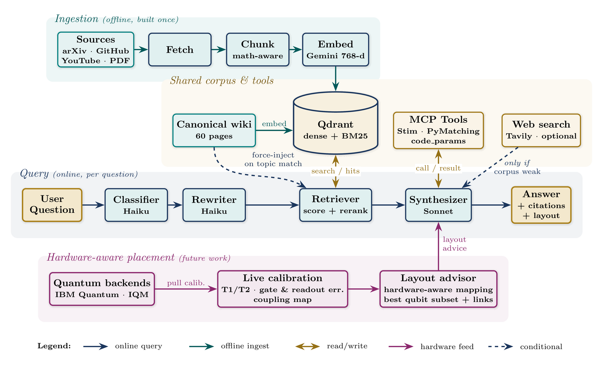

# ChatQEC

An open-source research assistant for **Quantum Error Correction**.

Ask QEC questions; get cited answers grounded in a curated corpus of papers,
textbook chapters, QEC vendor/lab pages, and a hand-curated canonical wiki.
Run small [Stim][Stim] circuits in a sandbox. Use it as a Python library, a CLI, or a
Streamlit web app. (GitHub-repo and video-transcript fetchers exist but the
corpus isn't seeded with them yet — see [Roadmap](#roadmap).)

[Stim]: https://github.com/quantumlib/Stim
> **Status: v0.1.0 — first public release.** The pipeline is end-to-end and
> testable; it ships with the full 60-page canonical wiki (chunked and embedded
> into Qdrant) and grows via the watchlist refresh job. See [Roadmap](#roadmap).

---

## Why

Existing chat assistants hallucinate on QEC: they confuse code distances,
misquote thresholds, fabricate paper titles, and can't run a stabilizer
circuit to check their own claim. ChatQEC is built specifically for QEC, with:

- **A curated wiki layer** of hand-reviewed canonical pages (surface code,
  stabilizer formalism, CSS codes, threshold theorem, magic state distillation)
  that bypass the retrieval ranking for definitional questions — if you ask
  "what is the surface code?", you always get the canonical page first.
- **Hybrid retrieval** (dense vectors + BM25 + cross-encoder reranking) over
  a typed source registry, with authority tiers and recency in the scoring.
- **Inline citations** to source IDs the reader can click and verify.
- **Sandboxed circuit tools** (Stim, LightStim, Tsim, GLCB) via a separate MCP
  tool server, so circuit-level questions get a real simulator answer — not a
  guess.
- **Honest refusals** when the evidence isn't in the corpus, instead of
  inventing a plausible-sounding one.

---

## Quick start

### Try it — CLI (`chatqec ask`)

```bash
git clone https://github.com/QSCSoftwareThrust/ChatQEC.git
cd ChatQEC
uv sync --extra dev

# bring up Qdrant for the vector store (starts empty)
docker compose up -d

# confirm it's up (REST API on :6333) — should print a JSON {"result": {...}}
curl -s http://localhost:6333/collections

# set API keys (or copy to .env)
export ANTHROPIC_API_KEY=sk-ant-...
export GEMINI_API_KEY=...
```

> **No Docker?** Run the native binary instead — no daemon, no root/sudo needed:
>
> ```bash
> mkdir -p logs
> QDRANT__STORAGE__STORAGE_PATH="$(pwd)/qdrant_data/storage" \
>   QDRANT__STORAGE__SNAPSHOTS_PATH="$(pwd)/qdrant_data/snapshots" \
>   setsid nohup qdrant > logs/qdrant.log 2>&1 < /dev/null &
> curl -s http://localhost:6333/collections   # same confirm step
> ```
>
> `setsid nohup ... &` keeps it running after you close the shell; logs land in
> `logs/qdrant.log`. It does *not* survive a reboot, so re-run it after one.
> `STORAGE_PATH` points at the same `qdrant_data/storage` the Compose file
> mounts, so both routes share one corpus; `SNAPSHOTS_PATH` keeps snapshot
> upload/restore (Option A below) inside the repo instead of the CWD.
> ([Install Qdrant](https://qdrant.tech/documentation/quick-start/) first if you don't have the binary.)

`docker compose up` gives you an **empty** Qdrant — the ingested chunks
themselves aren't in this git repo (only source metadata in
`sources/registry.jsonl` is). Pick one:

**Option A — I have a corpus snapshot** (fastest: skip ingestion entirely)

```bash
git clone git@code.ornl.gov:qsc-as/qec_corpus_snapshot.git
curl -X POST 'http://localhost:6333/collections/chatqec_chunks/snapshots/upload?priority=snapshot' \
  -H 'Content-Type: multipart/form-data' \
  -F 'snapshot=@qec_corpus_snapshot/chatqec_chunks.snapshot'
```

See that repo's README for the checksum and what commit it was built from.

**Option B — I don't have a corpus** (build it yourself; takes longer, needs
`GITHUB_PERSONAL_ACCESS_TOKEN` for GitHub sources)

```bash
chatqec canonical embed              # 60-page hand-curated wiki — quick, no network fetch
# then optionally re-populate the rest of the corpus, source by source:
chatqec ingest --arxiv <id> --full-text
chatqec ingest --github <org/repo> --commit-sha <sha> --github-paths docs
chatqec embed --all-pending --provider gemini
```

`sources/registry.jsonl` lists every source currently in the corpus if you
want to reproduce it fully — there's no single bulk "replay the registry"
command yet, so this is source-by-source.

Either way, once the corpus is in Qdrant:

```bash
uv run chatqec ask "What is the surface code threshold under depolarizing noise?"
```

### Enable QEC tool execution (Stim, LightStim, Tsim, GLCB)

Clone and install the sibling MCP server, then point `--mcp-server` at it:

```bash
git clone https://github.com/QSCSoftwareThrust/chatqec-mcp-tools ~/chatqec-mcp-tools
uv tool install --force ~/chatqec-mcp-tools

uv run chatqec ask --mcp-server chatqec-mcp-tools \
  "Simulate a 3-qubit bit-flip repetition-code syndrome circuit in Stim for 2000 \
   shots and report the syndrome distribution."
```

> **The installed command is a snapshot.** `uv tool install` freezes the server at
> install time, so **after adding or changing tools in the sibling repo you must
> reinstall** or the new tools won't be exposed:
>
> ```bash
> uv tool install --force ~/chatqec-mcp-tools   # re-expose e.g. pymatching_decode, code_params, qec_circuit_build, tsim_simulate, glcb_visualize_url
> ```
>
> Check what tools the model can actually see:
>
> ```bash
> uv run python -c "from chatqec.cli import _build_chatqec; \
>   b=_build_chatqec(mcp_server='chatqec-mcp-tools'); \
>   print([t.name for t in b.synthesizer.mcp_adapter.client.list_tools()])"
> # → ['stim_simulate', 'stim_diagram', 'pymatching_decode', 'threshold_sweep', 'code_params', 'qec_circuit_build', 'tsim_simulate', 'glcb_visualize_url']
> ```

The model **decides on its own** when a question needs simulation and calls the
MCP tools — `stim_simulate`, `stim_diagram`, `pymatching_decode`,
`threshold_sweep`, `code_params`, `qec_circuit_build`, `tsim_simulate` — which
run in a subprocess sandbox with memory and wall-clock limits.
`glcb_visualize_url` is the one exception: it's pure string/URL encoding with
no external process, no network call, and no dependency, so no sandbox
applies. Reported numbers come from the tool's actual output, not the model's
guess.

> **`qec_circuit_build` needs the sibling's optional `lightstim` extra.**
> The tool is always registered, but without `lightstim` installed it returns
> `ok=False` for every call. Reinstall with the extra to actually use it:
> `uv tool install --force "~/chatqec-mcp-tools[lightstim]"`. It builds circuits
> for code families Stim doesn't ship built-in (toric code, BB codes, PQRM,
> plus LightStim's own construction of the 6.6.6 color code) — see
> [`docs/EXAMPLES.md`](docs/EXAMPLES.md#lightstim-via-qec_circuit_build) and
> [`docs/lightstim_capability_check.md`](docs/lightstim_capability_check.md).

> **`tsim_simulate` needs the sibling's optional `tsim` extra.** Like
> `qec_circuit_build`, the tool is always registered but returns `ok=False`
> for every call without it. Reinstall with the extra to actually use it:
> `uv tool install --force "~/chatqec-mcp-tools[tsim]"`. Unlike `lightstim`,
> `tsim` is a normal versioned PyPI dependency (`bloqade-tsim>=0.1.5,<0.2`,
> no commit-pin needed — see
> [`docs/DESIGN_CHOICES.md`](docs/DESIGN_CHOICES.md#why-tsim-needs-no-commit-pin-for-its-code-dependency-only-for-kb-ingestion)).
> It runs Stim-superset circuits — including non-Clifford gates (`T`,
> `T_DAG`, `R_X`/`R_Y`/`R_Z`, ...) plain Stim rejects outright — via
> [Tsim](https://github.com/QuEraComputing/tsim). `glcb_visualize_url` (no
> extra needed) builds a shareable QuEra Gemini Logical Circuit Builder link
> for a small circuit. See
> [`docs/EXAMPLES.md`](docs/EXAMPLES.md#tsim--glcb-via-tsim_simulate--glcb_visualize_url)
> and [`docs/tsim_glcb_capability_check.md`](docs/tsim_glcb_capability_check.md).

**Provider:** tool use works with the `anthropic`, `gemini`, or `auto` provider
(set `models.provider` in `conf/config.yaml`). Under `auto`, ChatQEC tries
Anthropic first and **automatically fails over to Gemini** on credit/auth errors —
so Stim answers keep working even when the Claude API is unavailable. (The
`huggingface` provider has no tool-use support.)

### Enable QAppsWiki search

ChatQEC can pull prose sections from [QAppsWiki](https://github.com/QSCSoftwareEcosystem/QAppsWiki)
(649 Error Correction Zoo code pages plus 42 other QEC/QEM pages, 691 under
`concepts/` in total) into the same
candidate pool as the corpus, by naming a **second** MCP server alongside the
Stim sibling. `CHATQEC_MCP_SERVER` (and `--mcp-server`) take a comma-separated
list, so one variable can name both:

```bash
git clone https://github.com/QSCSoftwareEcosystem/QAppsWiki ~/QAppsWiki

CHATQEC_MCP_SERVER="chatqec-mcp-tools,sh -c 'PYTHONPATH=/path/to/QAppsWiki/tools python -m qappswiki serve --root /path/to/QAppsWiki'" \
  uv run streamlit run chatqec_app/streamlit_app.py
```

`MultiMCPClient` fans out to both servers and skips whichever fails to start,
so a broken wiki clone degrades to Stim-only tools rather than a hard failure.
The wiki's MCP server is a **stdio subprocess that reads its own working
tree** (there is no hosted endpoint), so **QAppsWiki must be cloned locally**
and the paths above point at that clone. The `qappswiki` console script isn't
on `PATH` in this setup, hence launching it via `PYTHONPATH` + `python -m
qappswiki` rather than a bare `qappswiki serve`.

Two knobs in `conf/config.yaml` control the wiki side once its MCP server is
reachable:

```yaml
wiki:
  enabled: true   # query the wiki on every question; false = corpus-only
  k: 8             # sections requested per query, before reranking
```

Wiki sections are reranked together with Qdrant chunks by the same
cross-encoder. Each one carries an authority tier (`wiki_curated` or
`wiki_unverified`) derived from the page's own `provenance_status` frontmatter,
but that tier is currently only a label passed into the model's context block,
not a ranking weight: `TIER_WEIGHTS` is read solely by the corpus candidate
scoring, which wiki sections bypass by being appended straight to the rerank
pool. Wiki content therefore wins or loses purely on cross-encoder score today.
Whether the tier should also move the ranking is a deliberately deferred design
decision. See
[`docs/DESIGN_CHOICES.md`](docs/DESIGN_CHOICES.md#why-qappswiki-search-lives-in-qappswiki)
for the rationale. Use `-v` on `chatqec ask`/`chat` to trace whether the wiki
was queried and what it returned (there's no `CHATQEC_TRACE` env var; tracing
is a CLI flag).

This is new and **not yet measured** against the eval set. The recommended
way to check whether the wiki actually helps, or crowds out better corpus
chunks, is the same 62-pair eval run already used for every other retrieval
change:

```bash
uv run chatqec eval run --output eval/results.json
```

compared once corpus-only and once with the wiki's MCP server named, reading
off recall@K and citation accuracy for each (see [Eval](#eval)). **That
comparison has not been run for this feature.** One caveat as of this
writing: `chatqec eval run` has no `--mcp-server` option and does not read
`CHATQEC_MCP_SERVER`, unlike `ask`/`chat`, so today it always evaluates the
corpus-only pipeline regardless of environment. Until eval wiring picks up an
MCP server the same way `ask`/`chat` do, spot-check individual questions
instead: `chatqec ask --mcp-server "chatqec-mcp-tools,sh -c '...'"
"<question>"` against the same question without `--mcp-server`, comparing
citations.

### Run the Streamlit app

The app **starts a local Qdrant itself** if one isn't already listening, so
this is usually all you need:

```bash
CHATQEC_MCP_SERVER=chatqec-mcp-tools uv run streamlit run chatqec_app/streamlit_app.py
```

Autostart only fires when `store.qdrant_url` is local and a `qdrant` binary is
on PATH; it reuses `qdrant_data/`, logs to `logs/qdrant.log`, and leaves an
already-running Qdrant alone. Set `CHATQEC_AUTOSTART_QDRANT=0` to switch it off,
which hosted deploys should do. Without a binary you get the start command in
the error instead of a bare `Connection refused`.

To start Qdrant yourself (`docker compose up -d`, or the native binary):

```bash
mkdir -p logs
QDRANT__STORAGE__STORAGE_PATH="$(pwd)/qdrant_data/storage" \
  QDRANT__STORAGE__SNAPSHOTS_PATH="$(pwd)/qdrant_data/snapshots" \
  setsid nohup qdrant > logs/qdrant.log 2>&1 < /dev/null &
curl -s http://localhost:6333/collections   # expect {"result":{"collections":[{"name":"chatqec_chunks"}]},...}
```

Then:

```bash
uv run streamlit run chatqec_app/streamlit_app.py

# …or with QEC tool use enabled (same as `ask --mcp-server`):
CHATQEC_MCP_SERVER=chatqec-mcp-tools uv run streamlit run chatqec_app/streamlit_app.py
```

Four pages: **Chat** (streaming Q&A with citation cards), **Sources**
(filterable registry view), **Watchlist** (what we track), **About**. Set
`CHATQEC_MCP_SERVER` to let the Chat page run the QEC tools (off by default).

> **`CHATQEC_MCP_SERVER` must be set _before_ you launch Streamlit, and the app
> restarted** to pick it up — the bot is built once and cached (`@st.cache_resource`).
> Without it the Chat page has no tools, so the model answers from the corpus and
> says it *"couldn't invoke the live simulation tools."* Make sure the sibling is
> installed/up to date first (see
> [Enable QEC tool execution](#enable-qec-tool-execution-stim-lightstim-tsim-glcb)
> above).

### CLI commands at a glance

```bash
chatqec ask "..."         # one-shot question with citations
chatqec chat              # interactive REPL (/quit, /clear)
chatqec ingest --arxiv 2408.13687 --url https://...   # add a source (abstract only)
chatqec ingest --arxiv 2408.13687 --full-text         # ingest the full paper (LaTeX source → Marker PDF fallback)
chatqec ingest --pdf Raw/book.pdf --pages 46-77 --title "..." --describe-figures  # book chapter + figure vision
chatqec ingest --github QuTone/LightStim --commit-sha <sha> --github-paths docs/api --github-paths skills  # pinned repo docs
chatqec embed --all-pending --provider gemini         # embed → flip to active
chatqec sources list                                  # registry view
chatqec retrieve --query "..."                        # debug: top-K chunks only (no LLM)
chatqec canonical validate                            # check the canonical wiki
chatqec canonical embed                               # chunk + embed canonical pages into Qdrant
chatqec ask "..." --image fig.png                     # multimodal: attach an image to the question
chatqec watch refresh --apply                         # pull new arXiv/GitHub candidates
chatqec eval run --output eval/results.json           # run the 62-pair eval set
```

> **Tip — verify retrieval without Anthropic credit.** `chatqec retrieve --query "..."` exercises only Gemini embeddings + Qdrant + the BGE reranker, **no
> Claude calls**. Use it to confirm the corpus is queryable before spending on
> the LLM synthesis step.

### Full-text vs. abstract ingestion

By default `chatqec ingest --arxiv <id>` stores only the **abstract** (one
chunk) — cheap, high-signal coverage that's enough to *find and cite* a paper.
Add `--full-text` to ingest the whole paper for depth on *how/why* questions:

- **LaTeX source (primary).** arXiv ships the original LaTeX for most papers.
  Equations (`$...$`, `\begin{equation}`) and code (`lstlisting`, `verbatim`)
  are preserved verbatim; figure images are dropped but `\caption{}` text is
  kept. This is the highest-fidelity path and needs no extra dependencies.
- **Marker PDF fallback.** For the minority of papers arXiv serves as PDF-only,
  the PDF is extracted with [Marker](https://github.com/datalab-to/marker) run
  in an **isolated `uvx` environment** (it pins `transformers` 4.x; the main env
  keeps 5.x), reconstructing equations to LaTeX. Set `TORCH_DEVICE=cuda` to use
  a GPU. Models download on first run.
- **Abstract (last resort)** if neither path yields usable text.

Add `--describe-figures` to also harvest **figures** from a full-text arXiv
paper (**hybrid ingest**): the LaTeX chunks stay authoritative for text and
equations, while the paper's PDF is fetched purely to persist its figure images,
which are then vision-described and appended as searchable figure chunks — the
same figure pipeline as `--pdf` below. Requires the `vision` extra + a GPU; on a
host without one the harvest is skipped automatically and text ingestion is
unaffected. The arXiv publication **year is filled in automatically** from the
resolved paper metadata, so figure and text chunks share the same recency score.

```bash
chatqec ingest --arxiv 2408.13687 --full-text --describe-figures
```

Reserve `--full-text` for impactful papers — see
[`scripts/reingest_arxiv_fulltext.sh`](scripts/reingest_arxiv_fulltext.sh) for a
reproducible batch re-ingest of the foundational QEC set.

### PDF ingestion with figures (`chatqec ingest --pdf`)

`chatqec ingest --pdf` extracts a book chapter or paper PDF via Marker and, by
default, also persists every figure it finds to `data/figures/<source_id>/`,
describes each one with a **local Llama-3.2-11B-Vision-Instruct** model
(US-origin, runs on your own GPU — zero API cost), and injects the
description into the chunk text as a `> **Figure (auto-described):** …`
callout so figures become semantically searchable and get cited like any
other evidence. The figure path is recorded in the chunk's metadata and
surfaced back to the user at answer time (the CLI prints a `Figures:` block;
Streamlit renders the images inline).

```bash
# --year drives recency scoring (see below); --describe-figures is the default
# (pass --no-describe-figures to skip figure vision).
chatqec ingest --pdf Raw/book.pdf --pages 46-77 \
  --title "Introduction to QEC" --year 2013 --describe-figures
```

> **Always pass `--year <publication-year>` for `--pdf` ingests.** Retrieval
> scores each chunk partly by recency (a 5-year time decay), and figures inherit
> their source's year. arXiv ingests fill the year in automatically, but a PDF
> has no reliable year metadata — omit `--year` and the whole source (text *and*
> figures) is scored **neutral** (0.5) instead of by its real age. If you forgot
> it, you can patch `sources/registry.jsonl` and the store payload after the fact
> (`meta_year`), but setting it at ingest time is the clean path.

Vision description requires the optional `vision` extra and a one-time
Hugging Face login (Llama-3.2-Vision weights are **gated** — accept the
license on the model page first):

```bash
uv sync --extra vision                # or: pip install -e '.[vision]'
huggingface-cli login                  # needed once, before first use
```

Without the extra installed (or with `--no-describe-figures`), PDF ingestion
still works exactly as before — figures just won't be described or made
searchable. `data/figures/` is a build artifact and is gitignored, same as
`data/chunks/`.

### Web-search fallback (Tavily)

When a question isn't covered by the corpus or canonical wiki, ChatQEC can
fall back to a web search (Tavily) and answer from cited web results instead
of refusing. **Off by default** — enable it with `TAVILY_API_KEY` in `.env`
plus `CHATQEC_WEB_FALLBACK=true`. The trigger is deterministic: it fires only
when the best retrieved chunk's cross-encoder rerank score falls below a
calibrated threshold (0.4). Web results sit at the lowest `web` authority tier
(0.3, below `blog`), so they never outrank canonical pages or papers, and the
model discloses when it relies on web sources and cites the URL. Results are
ephemeral — nothing is written to the corpus — and the CLI prints a
`chatqec ingest --url <url>` tip so you can promote a good source into the
permanent corpus. No new dependency: Tavily is called via the existing
`requests` library.

---

## What to expect on your first run

**The corpus is intentionally small at v0.1.0.** Beyond a small seed corpus, the
60-page canonical wiki is pre-loaded and embedded into Qdrant; the registry grows
from there via the watchlist. Definitional questions on these topics return cited
answers immediately:

- Surface code
- Stabilizer formalism
- CSS codes
- Threshold theorem
- Magic state distillation

Anything outside that scope will return an honest refusal — not a
hallucinated answer. To get broader coverage, ingest sources via
`chatqec ingest` (or wait for the watchlist refresh) before asking.

**Costs.** A typical single-turn query costs roughly $0.01–$0.03 (one Haiku
classification + one Haiku rewrite + one Sonnet synthesis, all uncached).
Streaming and tool-use add a small overhead. The `chatqec.guards.CostBudget`
caps daily spend; the default is $5/day and is configurable via
`CHATQEC_DAILY_BUDGET_USD`.

**LLM provider is configurable and falls back automatically.** The default
config is `models.provider: "auto"` — calls go to Anthropic first; if your
Anthropic credit is empty (or the key is missing, rate-limited, or 403s) the
same call transparently falls through to Gemini, then to HuggingFace
open-weights (Llama-3.1-8B for classifier+rewriter, Llama-3.3-70B for
synthesizer+judge) if Gemini is also unavailable. Every call logs
which backend served it to stderr — there's no silent quality drop:

```
$ chatqec ask "..."
[chatqec] backend=anthropic unavailable (BadRequestError: credit balance too low) → trying next
[chatqec] backend=gemini unavailable (PermissionDenied: API key not valid) → trying next
[chatqec] backend=huggingface model=meta-llama/Llama-3.3-70B-Instruct
The surface code threshold under depolarizing noise is...
```

Four explicit values are available for `models.provider`:

| Value                  | Behaviour                                                                                                                            |
| ---------------------- | ------------------------------------------------------------------------------------------------------------------------------------ |
| `auto` *(default)* | Try Anthropic → Gemini → HuggingFace, falling back on credit/auth/quota errors. Non-recoverable errors (5xx, network) still raise. |
| `anthropic`          | Anthropic only. Fails hard if no credit / no key.                                                                                    |
| `gemini`             | Gemini only. Fails hard if no credit / no key.                                                                                       |
| `huggingface`        | HuggingFace only. Useful for fully open-stack deploys.                                                                               |

Provide whichever keys you have: `ANTHROPIC_API_KEY`, `GEMINI_API_KEY`, and/or
`HF_TOKEN` (the
fine-grained token needs the **"Make calls to Inference Providers"** scope).
`auto` skips any backend whose key is missing — set just one and it works.

The `--mcp-server` tool-use loop still requires Anthropic; HuggingFace covers
the four text-only roles. Expect a measurable quality drop on synthesis when
the fallback kicks in — eval headline numbers should still be run with
`provider: anthropic` explicitly to avoid mixed-backend results.

---

## What's in the box

| Layer           | Module                                                                         | Notes                                                                                                                                                                                                                                                                                                                                                                                                                                                                                                                                          |
| --------------- | ------------------------------------------------------------------------------ | ---------------------------------------------------------------------------------------------------------------------------------------------------------------------------------------------------------------------------------------------------------------------------------------------------------------------------------------------------------------------------------------------------------------------------------------------------------------------------------------------------------------------------------------------- |
| Canonical wiki  | [`knowledge/canonical/`](knowledge/canonical/)                                | 60 pages (full v1 roster + v0.4 additions in[`_roster.yaml`](knowledge/canonical/_roster.yaml)); chunked + embedded via `chatqec canonical embed`                                                                                                                                                                                                                                                                                                                                                                                           |
| Source registry | [`sources/registry.jsonl`](sources/registry.jsonl)                            | Typed JSONL; lifecycle states (`active`/`superseded`/`retracted`/`stale`/`pending_review`)                                                                                                                                                                                                                                                                                                                                                                                                                                           |
| Watchlist       | [`sources/watchlist.yaml`](sources/watchlist.yaml)                            | arXiv categories, GitHub repos, YouTube channels                                                                                                                                                                                                                                                                                                                                                                                                                                                                                               |
| Ingestion       | [`src/chatqec/ingestion/`](src/chatqec/ingestion/)                            | Fetchers (arXiv abstract / arXiv full-text LaTeX source / Marker PDF / GitHub, pinned to an exact commit via`--commit-sha` / YouTube / URL), math-aware chunker, title-and-author resolver, local Llama-3.2-Vision figure describer (`--extra vision`)                                                                                                                                                                                                                                                                                     |
| Embedding       | [`src/chatqec/embedding/`](src/chatqec/embedding/)                            | Gemini (default) or local BGE/Nomic; BM25 via fastembed                                                                                                                                                                                                                                                                                                                                                                                                                                                                                        |
| Store           | [`src/chatqec/store/qdrant.py`](src/chatqec/store/qdrant.py)                  | Hybrid dense + sparse search                                                                                                                                                                                                                                                                                                                                                                                                                                                                                                                   |
| Retrieval       | [`src/chatqec/retrieval/`](src/chatqec/retrieval/)                            | Spec §8.5 weighted scoring (`0.5·dense + 0.3·bm25 + 0.15·tier + 0.05·recency`), BGE cross-encoder reranker, canonical force-injection                                                                                                                                                                                                                                                                                                                                                                                                   |
| Conversation    | [`src/chatqec/conversation/`](src/chatqec/conversation/)                      | Haiku off-topic classifier + query rewriter; Sonnet synthesizer with native tool-use loop                                                                                                                                                                                                                                                                                                                                                                                                                                                      |
| Guards          | [`src/chatqec/guards/`](src/chatqec/guards/)                                  | Per-IP rate limit, daily USD budget, hCaptcha verifier                                                                                                                                                                                                                                                                                                                                                                                                                                                                                         |
| Eval            | [`src/chatqec/eval/`](src/chatqec/eval/) + [`eval/`](eval/)                  | 62-pair Q&A set across 7 subtypes; recall@K + citation accuracy + LLM-judge faithfulness                                                                                                                                                                                                                                                                                                                                                                                                                                                       |
| MCP tools       | [`chatqec-mcp-tools`](https://github.com/QSCSoftwareThrust/chatqec-mcp-tools) | `stim_simulate` (run circuit → samples), `stim_diagram` (circuit → SVG), `pymatching_decode` (MWPM decode → logical error rate), `threshold_sweep` (p × distance → table + log-log SVG), `code_params` ([[n,k]] + stabilizer count + Stim-computed distance), `qec_circuit_build` (toric/BB/PQRM code circuits via LightStim, optional `lightstim` extra), `tsim_simulate` (Stim-superset + non-Clifford gates via Tsim, optional `tsim` extra), `glcb_visualize_url` (shareable GLCB circuit link, no extra) over MCP stdio |
| QAppsWiki search | [`src/chatqec/retrieval/wiki_search.py`](src/chatqec/retrieval/wiki_search.py) | Wraps the [QAppsWiki](https://github.com/QSCSoftwareEcosystem/QAppsWiki) MCP `search_pages` tool (self-hosted BM25 over ~3,778 sections from 691 concept pages) into `RetrievedChunk`s that join the same cross-encoder rerank pass as corpus chunks; needs the wiki's MCP server named alongside `chatqec-mcp-tools` (see [Enable QAppsWiki search](#enable-qappswiki-search)) |

Full corpus breakdown (chunk counts, per-source stats) lives in
[`docs/EXAMPLES.md`](docs/EXAMPLES.md); as of 2026-07-28 the store has 2,935
embedded chunks across 123 sources (60 canonical, 30 arXiv, 6 book chapters,
25 blog/vendor, 2 pinned GitHub-doc sources) — computed live from
`sources/registry.jsonl`, not estimated.

---

## How it works



*Ingestion (offline), the shared corpus/tools layer, and the query pipeline are
implemented today. The bottom **Hardware-aware placement** lane (live IBM
Quantum/IQM calibration → layout advisor) is **future work** — see
[Roadmap](#roadmap).*

The query lane in detail:

```
                       ┌──────────────┐
question  ──▶ Haiku ──▶│  off-topic?  │── no ──▶ refuse politely
                       └──────┬───────┘
                              │ yes
                       ┌──────▼───────┐
                       │   Haiku      │  resolves pronouns,
                       │   rewriter   │  emits 2–3 search variants
                       └──────┬───────┘
                              │
        ┌─────────────────────▼──────────────────────┐
        │      Hybrid retriever (Qdrant + BM25)      │
        │ → spec §8.5 scoring → BGE reranker → top-K │
        │     ▲                                       │
        │     │  canonical wiki force-inject          │
        └─────┼───────────────────────────────────────┘
              │
       ┌──────▼─────────┐         ┌───────────────────────┐
       │ Sonnet         │  tools  │  MCP adapter          │
       │ synthesizer    │ ◀────▶ │  → stim_simulate      │
       │ (cited answer) │         │  → stim_diagram       │
       └────────────────┘         │  → pymatching_decode  │
                                   │  → threshold_sweep    │
                                   │  → code_params        │
                                   │  → qec_circuit_build  │
                                   │  → tsim_simulate      │
                                   │  → glcb_visualize_url │
                                   └───────────────────────┘
```

> When retrieval is weak (best rerank score < 0.4) and the web fallback is
> enabled, Tavily results are injected into the hybrid retriever as
> lowest-authority `web`-tier context instead of the pipeline refusing.

**Why each piece?** See [`docs/DESIGN_CHOICES.md`](docs/DESIGN_CHOICES.md) for a
focused walkthrough of model selection (why Haiku for the classifier, Sonnet
for the synthesizer, BGE for the reranker, etc.) and architectural picks (why
hybrid retrieval, why Qdrant, why MCP for tool use, why a canonical wiki
layer, why auto-fallback). Full design spec:
[`docs/planning/specs/2026-05-29-chatqec-design.md`](docs/planning/specs/2026-05-29-chatqec-design.md).

---

## Configuration

ChatQEC uses Hydra + OmegaConf. The root config is
[`conf/config.yaml`](conf/config.yaml); override anything from the command line:

```bash
uv run chatqec ask "..." --mcp-server chatqec-mcp-tools
CHATQEC_DAILY_BUDGET_USD=2.50 uv run streamlit run chatqec_app/streamlit_app.py
```

Required environment:

| Variable                                    | Purpose                                                                                                            |
| ------------------------------------------- | ------------------------------------------------------------------------------------------------------------------ |
| `ANTHROPIC_API_KEY`                       | Haiku (classifier/rewriter) + Sonnet (synthesizer + judge) — required when`models.provider=anthropic` (default) |
| `HF_TOKEN` *or* `HUGGINGFACE_API_KEY` | Llama-3.1/3.3 via HuggingFace Inference API — required when`models.provider=huggingface`                        |
| `GEMINI_API_KEY`                          | `gemini-embedding-001` for dense vectors (or set `embedding.provider=local`)                                   |
| `HCAPTCHA_SECRET`                         | Optional. Public Streamlit deploys; empty = captcha disabled                                                       |
| `CHATQEC_DAILY_BUDGET_USD`                | Optional. Daily USD cap for the budget guard                                                                       |
| `WATCHLIST_PUSH_TOKEN`                    | CI-only. GitLab token for the scheduled watchlist refresh MR                                                       |

---

## Eval

```bash
uv run chatqec eval run \
  --cases eval/qa_set.jsonl \
  --output eval/results.json
```

The seed set has 50 Q&A pairs across six subtypes:

| Subtype        | Cases |
| -------------- | ----- |
| definition     | 8     |
| paper_lookup   | 8     |
| comparison     | 9     |
| math_detail    | 9     |
| recent_niche   | 8     |
| code_execution | 8     |

Metrics: **recall@K** (did the retriever surface a relevant source?),
**citation accuracy** (did the answer's citations point to the right sources?),
and **faithfulness** (LLM-judged: do the answer's claims follow from the
retrieved evidence?). Run output is JSON with per-subtype + overall scores.

> Headline numbers will land once the corpus is seeded. The pipeline is
> end-to-end testable now; meaningful eval scores need real content.

---

## Roadmap

**v0.1.0 (this release):**

- ✅ End-to-end pipeline: classifier → rewriter → hybrid retrieval → synthesizer
- ✅ Canonical wiki layer — chunked + embedded into Qdrant (`chatqec canonical embed`)
- ✅ Multimodal image input (`chatqec ask --image` + Streamlit attach) with Gemini-Flash captioning for retrieval
- ✅ PDF book-chapter ingestion (`chatqec ingest --pdf`) + `chatqec corpus-stats`
- ✅ Figure ingestion: persisted images, local Llama-3.2-Vision descriptions, searchable + shown at answer time
- ✅ Sandboxed Stim execution via MCP sibling repo
- ✅ Streamlit app with per-IP rate limit, daily budget, hCaptcha
- ✅ 62-pair eval set + `chatqec eval run`
- ✅ Watchlist refresh (arXiv + GitHub) with scheduled CI MR

**v0.2 — content & quality:**

- Populate the source registry to ~500 documents (seed via watchlist + bulk arXiv)
- ✅ Build out the canonical wiki to the full v1 roster (60 pages, per v0.4 below)
- Publish baseline eval numbers and the methodology behind them
- Hosted Streamlit demo
- ✅ Distribute the prebuilt corpus as a Qdrant snapshot — currently as an
  internal GitLab repo (see Quick Start Option A above); still open: a public
  Hugging Face dataset repo with a dataset card pinning the embedding model
  (`gemini-embedding-001`, 768-d), the Qdrant version, and source licenses
  (provenance from `sources/registry.jsonl`).

**v0.3 — tooling:**

- ✅ PyMatching decoder tool
- qiskit-qec tool (in the MCP sibling) — **superseded** by the Stim-backed
  `code_params` tool; qiskit-qec is unshippable (not on PyPI, abandoned,
  broken against modern Qiskit)
- ✅ Threshold-sweep helper
- ✅ Real stdio MCP client (Stim tool-use now works) + Claude→Gemini tool failover

**v0.4 — corpus & fallback:**

- ✅ Expanded corpus: +11 foundational/FT + hardware-demo papers with full
  text and vision-described figures; +5 QEC vendor/lab pages (Google, IBM,
  Quantinuum); +4 canonical pages (erasure-conversion, real-time-decoding,
  below-threshold-scaling, mid-circuit-measurement) → 60 canonical pages
- ✅ Stim-backed `code_params` tool
- ✅ Optional Tavily web-search fallback (rerank-gated, calibrated threshold 0.4)

**v0.5 — more source types:**

- ✅ `chatqec ingest --github <org>/<repo> --commit-sha <sha>` wired to the CLI
  (pinned to an exact commit, never a branch — reuses the existing
  `GitHubMetadata`/`files_to_chunks` fetcher); `QuTone/LightStim` added to
  `sources/watchlist.yaml` so `chatqec watch refresh` surfaces upstream moves.
  First live run seeded `github:QuTone/LightStim@47dd7497` (79 chunks) +
  the full LightStim paper (`arxiv:2604.21472`, 39 chunks).
- Populate the corpus with **code repos** and **video/lecture transcripts** —
  the GitHub fetcher is now wired to `chatqec ingest` and seeded with one repo
  (LightStim); the YouTube fetcher already exists
  (`src/chatqec/ingestion/fetchers/`) and the watchlist tracks it, but the
  registry isn't seeded with any YouTube sources yet.

**v1.0 — production:**

- Real `from_config()` deploy flow with secret management
- Docker-isolated sandbox (current uses subprocess + rlimits)
- Per-source retraction propagation

**Later — exploratory:**

- **Hardware-aware placement.** Pull live calibration data (T1/T2, gate &
  readout error, coupling map) from real backends (IBM Quantum, IQM) and add a
  layout advisor that recommends the best qubit subset + links for a given
  code/circuit, feeding that advice into the synthesizer's answer. Shown as
  the "(future work)" lane in the [architecture diagram](#how-it-works) above;
  no implementation exists yet.

---

## Contributing

**Propose a source** for the corpus: open an issue using the
[`add_source` template](.gitlab/issue_templates/add_source.md). Maintainer
reviews license + relevance, then `chatqec ingest` plus the weekly watchlist
refresh keeps it current.

**Work on the code:**

```bash
uv sync --extra dev
uv run pytest                          # 416 tests, 90% line coverage
uv run ruff check src tests chatqec_app
uv run mypy src
uv run chatqec canonical validate
```

Conventional Commits + small, reviewable diffs. The design spec
([`docs/planning/specs/`](docs/planning/specs/)) and implementation plan
([`docs/planning/plans/`](docs/planning/plans/)) are the source of
truth — extend them before adding a feature outside the v1 scope.

---

## Citing

If ChatQEC helps your research, please cite it as:

```bibtex
@software{chatqec_2026,
  author  = {Sharmin Afrose, Vicente Leyton-Ortega, Travis Humble, Tirthankar Ghosal
},
  title   = {ChatQEC: an open-source research assistant for Quantum Error Correction},
  version = {0.1.0},
  year    = {2026},
  url     = {https://github.com/QSCSoftwareThrust/ChatQEC.git}
}
```

---

## Acknowledgements

This material is based upon work supported by the U.S. Department of Energy,
Office of Science, National Quantum Information Science Research Centers,
Quantum Science Center.
